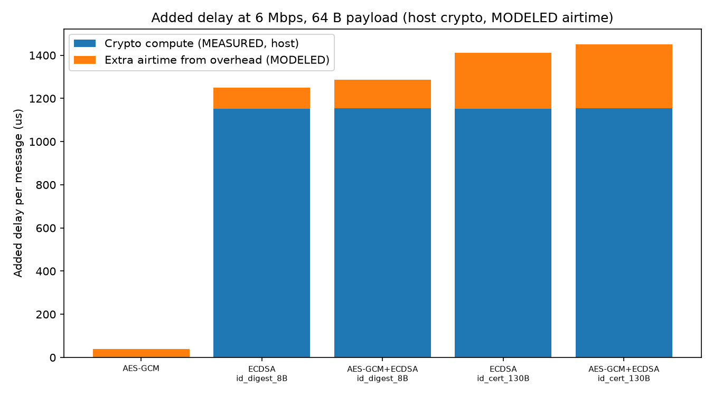
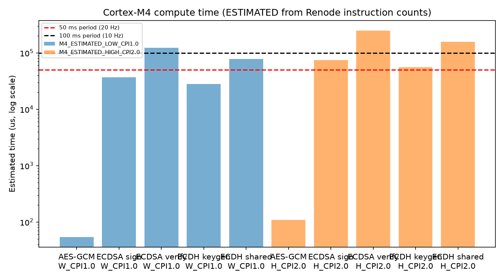
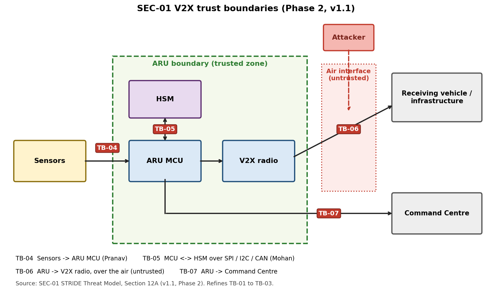

# SEC-01 Phase 3 Report: End-to-End V2X Encryption Delay (AES-GCM / ECC) and Zero-Trust Specification

**Author:** Rutvika Ashtekar, Cybersecurity Lead (Aerospace Security)
**Program:** SAARTHI Autonomous Infrastructure Programme, Phase 3 (Days 19 to 25, 1-week online gate)
**Document reference:** SAARTHI-SYS-P3-TASK-002
**Date:** 24 October 2026
**Task:** End-to-End V2X Telemetry Encryption Delay Models (AES-GCM / ECC over 6 Mbps / 10 Hz) and STRIDE Zero-Trust Spec. Work package 12: model the processing delay of AES-GCM and ECC over an 802.11p/C-V2X direct channel (6 Mbps PHY, 10 Hz / 20 Hz telemetry) "to ensure zero control loop latency degradation".

**Labeling rule:** every number is tagged **MEASURED (host)**, **MEASURED (Renode instruction count)**, **MODELED** or **ESTIMATED**. Host timings are not Cortex-M4 timings. Cortex-M4 times are **ESTIMATED** from Renode instruction counts using an assumed 168 MHz clock and an assumed 1.0 to 2.0 cycles per instruction. Renode counts instructions, not cycles.

---

## 1. Deliverables and GitHub Paths

Repository:  https://rutvikaashtekar1607.github.io/SAARTHI/

All paths are relative to the repository folder `V2X_Spec_SAARTHI`. `P3` = `SEC-01 V2X Cryptographic Specification/04_Phase3_E2E_Delay_Model`.

| # | Deliverable | Exact path |
|---|---|---|
| 1 | ECDSA P-256 host benchmark (C, Mbed TLS 3.6.7) | `P3/bench_ecdsa.c` |
| 2 | ECDSA results, 3 runs | `P3/results_ecdsa.csv`, `results_ecdsa_run2.csv`, `results_ecdsa_run3.csv` |
| 3 | End-to-end delay model | `P3/e2e_delay_model.py` |
| 4 | Model outputs | `P3/e2e_model_output.csv`, `P3/e2e_setup_output.csv` |
| 5 | Model assumptions | `P3/assumptions_phase3.md` |
| 6 | Cortex-M4 timing firmware | `P3/m4_bench.c`, `config_m4.h`, `linker.ld`, `startup.c` |
| 7 | Build and run scripts | `P3/build_m4.ps1`, `P3/run_m4.resc`, `P3/parse_m4_counts.py` |
| 8 | Renode instruction counts | `P3/m4_estimates.csv`, `P3/m4_counts_detail.csv` |
| 9 | Fault-injection tests | `P3/fault_tests.py`, `P3/fault_test_results.csv`, `P3/security_event_log.csv` |
| 10 | Zero-Trust specification (Section 14) | `SEC-01 V2X Cryptographic Specification/01_SEC-01_STRIDE_Threat_Model.md` |
| 11 | Visuals | `P3/e2e_added_delay.png`, `P3/m4_compute_vs_period.png`, `03_Phase2_Latency_Model/trust_boundaries.png` |
| 12 | This report | `SEC-01 V2X Cryptographic Specification/Phase3_Report.md` |
| 13 | Screenshot evidence | `Evidence/Phase3_*.png` |

Notes:
- Phase 2 files (host AES-GCM and ECDH results, `03_Phase2_Latency_Model`) are inputs to this work and were not changed.
- Phase 1 Renode firmware (`aes_gcm_benchmark.elf`, `ecc_benchmark.elf`) was **not** used. The Cortex-M4 firmware was rebuilt from the source files listed above.
- Build artifacts (`bench_ecdsa.exe`, `obj/`, `.elf`, `.map`) are excluded from the repository.

---

## 2. Quantified Results

### 2.1 ECDSA P-256 on the host, MEASURED (host)

C, Mbed TLS 3.6.7, i5-1135G7, 100 calls per repeat, 15 repeats, median per operation. The correctness check (valid signature verifies, tampered digest rejected) passed in all three runs. DER signature length was 70 to 71 B.

| Operation | Run 1 (µs) | Run 2 (µs) | Run 3 (µs) | Median of runs (µs) |
|---|---|---|---|---|
| ECDSA P-256 sign | 263.188 | 262.403 | 263.235 | 263.188 |
| ECDSA P-256 verify | 868.598 | 906.572 | 890.081 | 890.081 |

AES-GCM and ECDH host results are in the Phase 2 report (AES-GCM 64 B: 0.469 µs, 256 B: 1.272 µs, 1024 B: 3.110 µs; ECDH key generation 243.612 µs; shared secret 670.224 µs; median of three runs).

### 2.2 Cortex-M4 instruction counts, MEASURED (Renode 1.16.0)

Firmware `m4_bench.c` built with Arm GNU Toolchain 12.2.MPACBTI-Rel1 (gcc 12.2.1), Mbed TLS 3.6.7, `-O2`, `config_m4.h` (code 29,404 B text, 88 B data, 10,872 B bss). Each operation runs once as warm-up and five times between start and end markers; Renode hooks read the executed-instruction count at each marker. The run finished with `bench_done = 1`, `bench_status = 0` and 70 markers.

| Operation | Bytes | n | Min | Median | Max | Est. time at CPI 1.0 | Est. time at CPI 2.0 |
|---|---|---|---|---|---|---|---|
| AES-128-GCM encrypt | 64 | 5 | 9,138 | 9,138 | 9,144 | 0.054 ms | 0.109 ms |
| AES-128-GCM encrypt | 256 | 5 | 30,438 | 30,438 | 30,444 | 0.181 ms | 0.362 ms |
| AES-128-GCM encrypt | 1024 | 5 | 115,638 | 115,638 | 115,644 | 0.688 ms | 1.377 ms |
| ECDH P-256 key generation | n/a | 5 | 4,698,804 | 4,712,615 | 4,720,414 | 28.051 ms | 56.103 ms |
| ECDH P-256 shared secret | n/a | 5 | 13,164,342 | 13,169,923 | 13,186,541 | 78.392 ms | 156.785 ms |
| ECDSA P-256 sign | 32 (digest) | 5 | 6,223,693 | 6,230,018 | 6,237,141 | 37.083 ms | 74.167 ms |
| ECDSA P-256 verify | 32 (digest) | 5 | 20,848,784 | 20,848,784 | 20,848,787 | 124.100 ms | 248.200 ms |

The time columns are **ESTIMATED**: $t = N \cdot CPI / f$ with $f$ = 168 MHz. The conclusions below hold at both CPI values.

### 2.3 End-to-end delay model, 64 B payload, 6 Mbps

Paths: AES-GCM (28 B overhead), ECDSA (64 B signature plus signer identity: 8 B digest or 130 B certificate, both assumptions), and both together. Added delay is relative to the unsecured baseline (126.333 µs total).

**Host crypto times (MEASURED), airtime MODELED:**

| Path | Signer id | Added delay (µs) | Total one-way (µs) | % of 100 ms (10 Hz) | % of 50 ms (20 Hz) |
|---|---|---|---|---|---|
| AES-GCM | n/a | 38.271 | 164.605 | 0.165% | 0.329% |
| ECDSA | 8 B digest | 1249.269 | 1375.602 | 1.376% | 2.751% |
| AES-GCM + ECDSA | 8 B digest | 1287.540 | 1413.874 | 1.414% | 2.828% |
| ECDSA | 130 B cert | 1411.936 | 1538.269 | 1.538% | 3.077% |
| AES-GCM + ECDSA | 130 B cert | 1450.207 | 1576.540 | 1.577% | 3.153% |

**Cortex-M4 crypto times (ESTIMATED), airtime MODELED. Low = CPI 1.0, high = CPI 2.0:**

| Path | Signer id | Total one-way, low | Total one-way, high | % of 100 ms | % of 50 ms | Fits period? |
|---|---|---|---|---|---|---|
| AES-GCM | n/a | 0.272 ms | 0.381 ms | 0.27% to 0.38% | 0.54% to 0.76% | **Yes** |
| ECDSA | 8 B digest | 161.4 ms | 322.6 ms | 161% to 323% | 323% to 645% | **No** |
| AES-GCM + ECDSA | 8 B digest | 161.6 ms | 322.8 ms | 162% to 323% | 323% to 646% | **No** |
| ECDSA | 130 B cert | 161.6 ms | 322.8 ms | 162% to 323% | 323% to 646% | **No** |
| AES-GCM + ECDSA | 130 B cert | 161.7 ms | 323.0 ms | 162% to 323% | 323% to 646% | **No** |

**Authenticated session setup** (ECDH key agreement plus ECDSA on both handshake messages):

| Case | 8 B digest | 130 B certificate |
|---|---|---|
| Host (MEASURED crypto) | 4.58 ms | 4.91 ms |
| Cortex-M4 (ESTIMATED), CPI 1.0 | 535.7 ms | 536.0 ms |
| Cortex-M4 (ESTIMATED), CPI 2.0 | 1071.0 ms | 1071.3 ms |

Compute load per message period on the Cortex-M4 (ESTIMATED):

| Operation | At 10 Hz (100 ms) | At 20 Hz (50 ms) |
|---|---|---|
| AES-GCM, 64 B | 0.05% to 0.11% | 0.11% to 0.22% |
| ECDSA sign | 37% to 74% | 74% to 148% |
| ECDSA verify | 124% to 248% | 248% to 496% |

Other payloads (256 B, 1024 B) are in `e2e_model_output.csv`.

### 2.4 Fault-injection results (software simulation)

`fault_tests.py` simulates an AES-128-GCM sender and receiver with counter nonces. Result: **9 of 9 tests passed**, and 3 of 3 negative controls showed the expected weakness.

| Test | Fault injected | Requirement | Result |
|---|---|---|---|
| T1 | none, 20 valid messages | ZT-01 | PASS (20 of 20 accepted) |
| T2 | flipped ciphertext, tag and nonce bits | ZT-01, ZT-09 | PASS (3 of 3 rejected) |
| T3 | wrong key, unknown sender, forged high counter | ZT-01, ZT-02, ZT-09 | PASS (receiver state not advanced) |
| T4 | replay of newest, middle and oldest message | ZT-05 | PASS (3 of 3 rejected, no decryption) |
| T5 | 200 sender power drops at random points | ZT-04 | PASS (22,841 nonces, 0 duplicates) |
| T6 | 20 lost messages, a late old message, receiver reboot | ZT-05, ZT-09 | PASS |
| T7 | counter rolled back | ZT-04 | PASS (send blocked) |
| T8 | 700 replays or unknown senders, 300 forgeries | ZT-15 | PASS (0 decryptions for the 700; 300 forgeries capped at 50) |
| T9 | event-log counter across reboot | ZT-14 | PASS (monotonic) |
| T5c, T6c, T7c | volatile counters, nonce reuse (controls) | ZT-04, ZT-05 | Weakness shown: 20,689 nonce reuses; replay accepted after reboot; plaintext relation leaked |

### 2.5 Pass criteria for "zero control loop latency degradation"

"Zero" cannot be proven in general, so the following criteria were defined (proposed by the author; Adarsh Anurag left such assumptions to the author).

| # | Criterion | Result |
|---|---|---|
| C1 | Crypto runs in a task below GNC (priority 4) and Sensing (priority 3) and holds no shared lock | **Design requirement ZT-10; not yet verified** (needs the FreeRTOS trace from Rakshita Lakkanna B.) |
| C2 | Crypto compute plus airtime fits inside the message period | AES-GCM: **met** (host and M4). Software ECDSA: **not met** on the M4 |
| C3 | Per-operation compute load stays under 100% of the period | AES-GCM: met. ECDSA sign: 37% to 148%. ECDSA verify: 124% to 496%, **not met** |
| C4 | Interference from the Sensing and Communications tasks included | **Not included**: their execution times are unmeasured |

**Conclusion:** the AES-GCM path (per-message protection after an authenticated session) meets the timing criteria on the Cortex-M4, subject to C1 and C4. Software ECDSA P-256 per message does **not** fit the 10 Hz or 20 Hz periods on this Cortex-M4 at 168 MHz, even at the optimistic 1.0 cycles per instruction. The finding applies to a generic C build of Mbed TLS. Optimized or hardware-accelerated ECC could be much faster; that is not measured.

### 2.6 Limitations

- Cortex-M4 times are **ESTIMATED** from Renode instruction counts. Renode is instruction-accurate, not cycle-accurate, and does not model flash wait states. The clock (168 MHz) and the cycles-per-instruction range (1.0 to 2.0) are assumptions.
- Instruction counts depend on compiler and library version; they apply to the build described in 2.2.
- The firmware uses a **non-secure test random generator**, for timing only. The real entropy source (assumption A-03) is not tested.
- The 40 µs PHY overhead is an 802.11p assumption and does not apply to C-V2X (PC5) framing. The 64 B signature and the signer-identity sizes are assumptions to verify against IEEE 1609.2.
- The telemetry payload size (64 B base case) is the author's assumption, derived from Adarsh Anurag's state vector $x_{ARU}$; it is not an agreed value.
- The fault-injection tests simulate protocol logic in software. They do not test the HSM hardware, the radio, or real flash behaviour.
- Execution times of the Sensing and Communications tasks, and the WCET of a crypto task under load, were not available (Rakshita Lakkanna B. has not measured them).
- Phase 1 Renode results were not re-verified; they were not used here.

---

## 3. Code and Math

### 3.1 Delay equations

$$T_{total} = T_{tx} + T_{air} + T_{prop} + T_{rx}, \qquad T_{air} = T_{phy} + \frac{8\,(L + O)}{R}$$

$$\Delta T = T_{total} - \left(T_{phy} + \frac{8L}{R} + T_{prop}\right)$$

Per-path overheads $O$ and compute times:

| Path | $O$ (B) | $T_{tx}$ | $T_{rx}$ |
|---|---|---|---|
| AES-GCM | 28 | $T_{enc}$ | $T_{dec}$ |
| ECDSA | 64 + id (8 or 130) | $T_{sign}$ | $T_{verify}$ |
| AES-GCM + ECDSA | 28 + 64 + id | $T_{enc} + T_{sign}$ | $T_{dec} + T_{verify}$ |

with $R$ = 6 Mbps, $T_{phy}$ = 40 µs, $T_{prop}$ = 1 µs, and $T_{dec} = T_{enc}$ (assumption).

Authenticated session setup (public key $H = 65 + 64 + id$ bytes per handshake message):

$$T_{setup} = 2\,(T_{keygen} + T_{sign} + T_{verify} + T_{shared}) + 2\,(T_{air}(H) + T_{prop})$$

Cortex-M4 time estimate from a Renode instruction count $N$:

$$t = \frac{N \cdot CPI}{f}, \qquad f = 168\ \text{MHz},\quad CPI \in [1.0,\,2.0]$$

Worked example, AES-GCM, $L$ = 64 B, host: $\Delta T = 0.469 + 0.469 + 8 \cdot 28 / 6 = 38.271\ \mu s$; $T_{total} = 0.469 + (40 + 8 \cdot 92/6) + 1 + 0.469 = 164.605\ \mu s$.

### 3.2 Instruction counting in Renode (`run_m4.resc`)

```text
$addr = `sysbus GetSymbolAddress "bench_marker"`
sysbus AddWatchpointHook $addr DoubleWord Write "import sys; sys.marks.append((value, cpu.ExecutedInstructions))"
emulation RunFor "00:00:08"
```

Firmware writes `(op_id << 8) | 1` before and `(op_id << 8) | 2` after each operation; the count for an operation is the difference between its end and start marker.

### 3.3 Nonce counter with write-ahead reservation (`fault_tests.py`)

```python
if persistent:
    self.counter = nvm.get("reserved", 0)     # resume at the reserved value
    self.limit = self.counter + BLOCK
    nvm["reserved"] = self.limit              # persist BEFORE using the block
```

After a power drop the sender resumes at the persisted reservation, skipping unused values, so a nonce is never reused.

### 3.4 Receiver check order (`fault_tests.py`)

Cheap checks first (known sender, counter greater than the last accepted one, authentication budget), then decryption; receiver state advances only after a message authenticates.

---

## 4. Visual Assets

**Figure 1: Added delay at 6 Mbps, 64 B payload (host crypto MEASURED, airtime MODELED)**


**Figure 2: Cortex-M4 compute time vs message periods, log scale (ESTIMATED from Renode instruction counts)**


**Figure 3: Trust boundaries TB-04 to TB-07 (STRIDE spec Section 12A)**


Terminal evidence: `Evidence/Phase3_01_ECDSA_Host_Runs.png`, `Phase3_02_E2E_Model_Output.png`, `Phase3_03_M4_Build.png`, `Phase3_04_Renode_Run.png`, `Phase3_05_M4_Counts.png`, `Phase3_06_E2E_Model_M4.png`, `Phase3_07_ZeroTrust_Spec.png`, `Phase3_08_Fault_Tests.png`, `Phase3_09_GitHub_Repo.png`.

---

## 5. References and Cross-Lead Collaboration

### 5.1 References

- [Ref: Phase 3 Task Allocation Matrix & Virtual Integration Directive, SAARTHI-SYS-P3-TASK-002]: task definition, 6 Mbps / 10 Hz / 20 Hz, FreeRTOS task periods, virtual fault-injection mandate.
- [Ref: SEC-01 Phase 2 Report, `Phase2_Report.md`]: host AES-GCM and ECDH results, Phase 2 delay model.
- [Ref: SEC-01 STRIDE Threat Model, Sections 5, 6, 12A and 14]: threats, trust boundaries TB-04 to TB-07, assumptions A-01 to A-10, Zero-Trust requirements ZT-01 to ZT-15.
- [Ref: `assumptions_phase3.md`]: Phase 3 model assumptions.
- [Ref: NIST SP 800-38D, Recommendation for GCM and GMAC]: nonce and tag requirements.
- [Ref: IEEE 802.11p / IEEE 1609.2]: PHY rate basis and signature and certificate formats (sizes used here are assumptions to verify).

### 5.2 Cross-lead collaboration

| Lead | Collaboration | Status |
|---|---|---|
| Rakshita Lakkanna B. (Real-Time Systems) | Provided FreeRTOS task periods and priorities (GNC 10 ms / 4, Sensing 20 ms / 3, Communications 50 ms / 2, Telemetry 100 ms / 1). Confirmed 10 Hz maps to the 100 ms Telemetry task. Noted the 20 Hz messages map to a priority-2 task, below GNC and Sensing. Sensing and Communications execution times and crypto WCET are not yet measured; she will compare against her Renode traces once estimates are shared | Task periods **confirmed**; timing data **pending** |
| Adarsh Anurag (GNC) | Telemetry payload size and communications budget were left to the author's assumptions | Assumptions delegated |
| K. Mohan Krishna (Hardware Security) | Review of Zero-Trust spec items ZT-04 (persistent nonce counter), ZT-06, ZT-07, ZT-08 and ZT-12 (HSM-assisted ECDSA) | <<Review requested; update to Reviewed when he replies>> |
| Deepayan Das (Systems Integration) | 6 Mbps baseline rate and message rates (Phase 2 confirmation, repeated in the Phase 3 directive) | **Confirmed** |
| Smrithi (ICD collation) | Format and location for Phase 3 IF-DATA submission | <<Pending>> |

---

## 6. Zero-Trust Specification (summary)

Section 14 of the STRIDE file defines five principles (no implicit trust, verify explicitly, least privilege, assume breach and fail closed, short-lived secrets) and 15 requirements, ZT-01 to ZT-15, each tied to threat IDs, a boundary, a verification method and a status. Key decisions:

- **Unicast links** (ARU to Command Centre): mutually authenticated ECDH + ECDSA session, then per-message AES-128-GCM with counter nonces. Public-key cost is paid once per session (ESTIMATED 0.54 to 1.07 s on the Cortex-M4).
- **Broadcast safety messages**: a shared symmetric key cannot show which key holder sent a message, so per-message sender authentication is needed. Software ECDSA is not viable on the Cortex-M4 (Section 2.5), so the path (HSM or hardware-assisted ECDSA, or a documented selective-verification policy) is an **open decision** (ZT-12).
- Requirements verified in software simulation (protocol logic only): ZT-01, 02, 04, 05, 09, 14 and 15. ZT-04 still needs the HSM nonce counter confirmed by Mohan. ZT-10 and the HSM requirements (ZT-06, 07, 08) are not verified.

---

## 7. Next-Task Recommendation

1. **HSM or hardware ECDSA offload** with Mohan's HSM: measure sign and verify latency including SPI / I2C / CAN bus transfer, and decide the broadcast authentication path (ZT-12).
2. **Crypto-task WCET and jitter under FreeRTOS load** in Renode with Rakshita, replacing the ESTIMATED values and closing criteria C1 and C4.
3. **Optimized ECC measurement**: repeat the Cortex-M4 count with an optimized P-256 implementation, to check whether software ECDSA can approach the period.
4. **HSM nonce-counter persistence test** across reboot and power loss with Mohan's FSM (ZT-04, A-01).
5. **Agree the telemetry payload size and key-rotation interval** (ZT-06) with Adarsh and Mohan, and update the model.
6. **Phase 4 hardware**: cycle counts from the DWT counter on real STM32F4 hardware to replace the CPI assumption.

---

## Status of Open Items

| Item | Status |
|---|---|
| Mohan's review of Zero-Trust items | <<Pending / Reviewed>> |
| Smrithi's submission format for IF-DATA | <<Pending>> |
| Rakshita: Sensing, Communications and crypto-task timing | Pending (unmeasured) |
| Broadcast authentication path (ZT-12) | Open decision |
| Telemetry payload size, key-rotation interval | Assumed / open |
